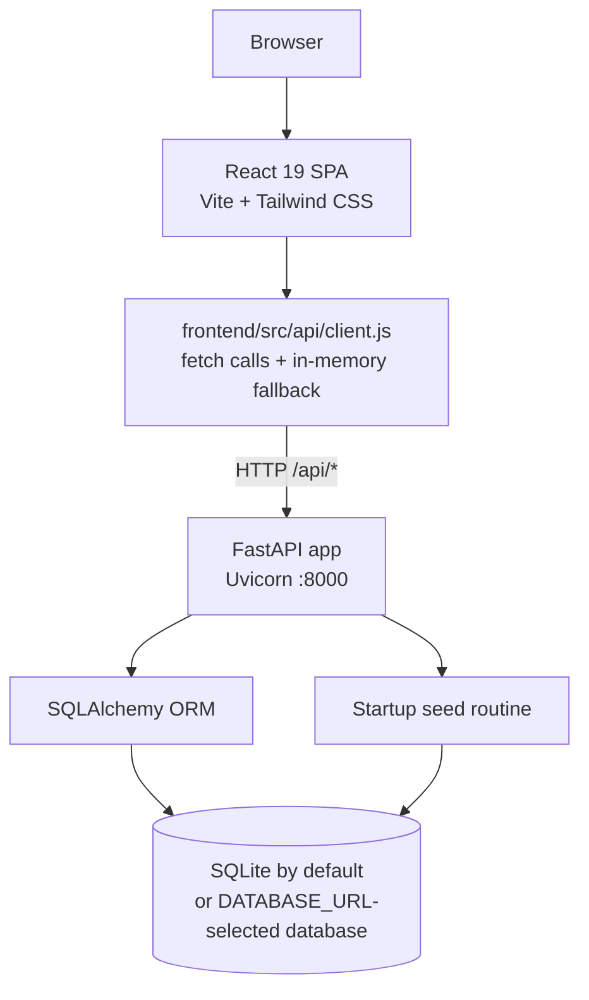
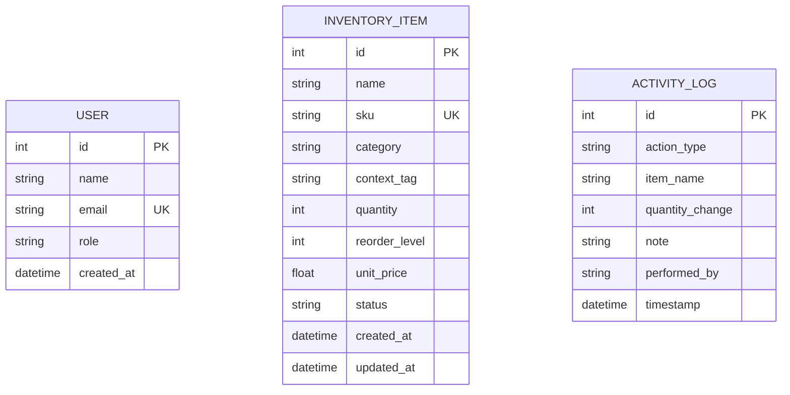

# ResourceOne — Architecture

## Current prototype architecture

The frontend is served by Vite during development, normally at `http://localhost:5173`. The API is served separately by Uvicorn at `http://127.0.0.1:8000`. The frontend API client currently hard-codes `http://127.0.0.1:8000/api`.

## Current backend modules

- `backend/app/main.py`: FastAPI application, route handlers, CORS, table creation, and startup seeding.
- `backend/app/database.py`: SQLAlchemy engine/session setup. Uses `DATABASE_URL` from the process environment and defaults to SQLite.
- `backend/app/models.py`: `User`, `InventoryItem`, and `ActivityLog` models.
- `backend/app/schemas.py`: Pydantic request and response schemas.
- `backend/app/seed.py`: sample inventory, user records, and activity-log data.

## Data model today

These tables describe the checked-in prototype. The target model in `PLAN.md` is broader and includes organizations, stock movements, purchases, donations, expenses, and more complete audit information; those should not be described as implemented until they exist in code.

## Request and stock-update flow

1. The browser calls the frontend API client.
2. The client requests an `/api/*` endpoint.
3. FastAPI validates request bodies using Pydantic schemas.
4. Route handlers query or update SQLAlchemy models.
5. Stock-changing endpoints add an activity-log record and commit the database transaction.
6. The frontend refreshes dashboard/inventory data. If the API is unreachable, some frontend operations use in-memory fallback data instead.

## Design decisions and trade-offs

- **SQLite default:** makes a local prototype easy to start without a database service. `DATABASE_URL` allows a compatible SQLAlchemy URL such as MySQL/PyMySQL, but the documented demo path should be tested against whichever database is selected.
- **Synchronous SQLAlchemy sessions:** simpler for this prototype and adequate for a small local demo.
- **Startup table creation and seeding:** `Base.metadata.create_all()` and the seed routine reduce setup steps, but there is no checked-in Alembic migration in this branch.
- **Frontend fallback data:** allows the UI to render when the API is down, but can make changes appear successful without persistence. Confirm backend status during a demo.
- **No authentication or authorization:** sample roles and the UI role selector are not security controls. API routes are currently open; do not deploy this prototype publicly.
- **CORS:** the current backend allows all origins. Restrict this before any deployment beyond local development.
- **No Docker:** consistent with the completion plan's decision to use native processes instead of containers.

## Planned architecture versus current implementation

The completion plan describes a future architecture with JWT authentication, role-based access control, organization scoping, MySQL 8, Alembic migrations, finance flows, and reporting. Those are roadmap targets, not current capabilities on the `sora` branch. Keep demo and presentation claims aligned with the actual code.
